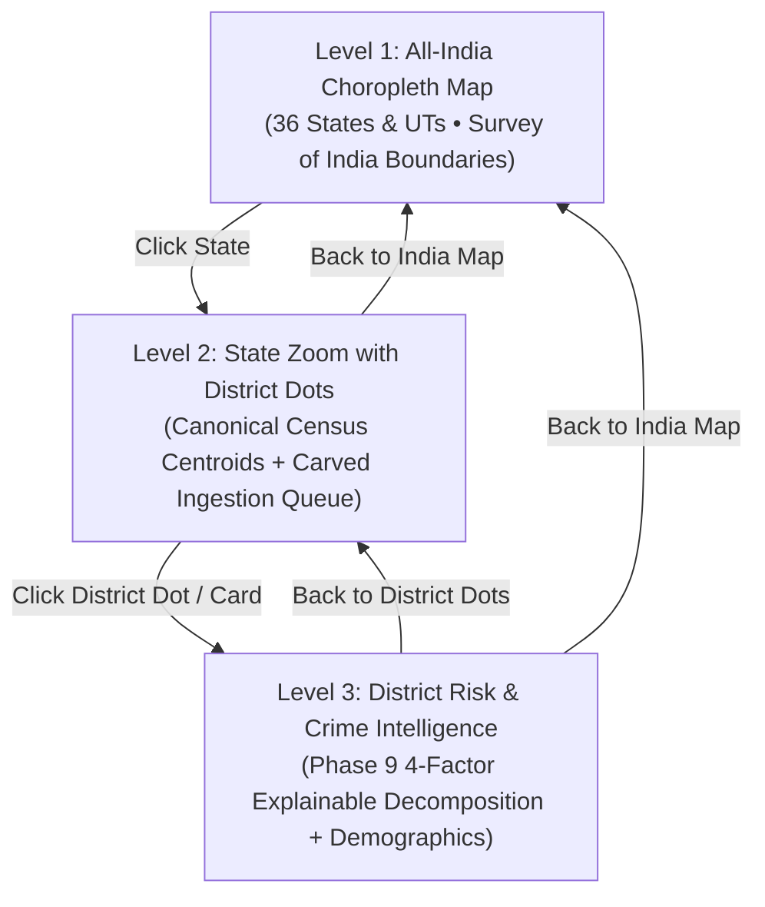

# Phase 7 — Three-Level Interactive Geographical Intelligence Verification Report

**Project**: Data-Driven Crime Management System with AI-Based Resource Optimization  
**Module**: Phase 7 Geographical Intelligence (GIS Map & Jurisdictional Exploration)  
**Status**: COMPLETED & VERIFIED  
**Date**: November 2026  

---

## 1. Executive Summary

The **Three-Level Interactive Geographical Intelligence** interface has been fully restored and integrated in `DistrictsPage.tsx` and `IndiaInteractiveMap.tsx`. The implementation strictly adheres to:
1. **Level 1 (All-India Choropleth)**: Official Survey of India state boundaries with nationwide crime intensity metrics (`Reported Crimes` vs. `Rate / 100k`), hover telemetry, and interactive state selection.
2. **Level 2 (State Zoom with Constituent District Dots)**: Bounding-box-based state zoom framing (`STATE_BBOX_MAP`), 637 canonical Census 2011 district centroids projected via affine transformation to SVG coordinates, risk-band color coding, interactive tooltips, and a separate dedicated container for modern carved districts pending coordinate ingestion (preventing coordinate fabrication).
3. **Level 3 (District Risk Assessment & Explainable Intelligence)**: Direct integration of Phase 9 Risk API (`/api/v1/risk/districts/{id}`) displaying composite risk scores (0–100), 4-factor mathematical decomposition (Volume 35%, Severity 30%, Trend 20%, Density 15%), separate ML forecast telemetry vs historical crime, plain-language explainability, Census 2011 demographic breakdown, category distribution, and longitudinal crime trends.

---

## 2. Three-Level Architecture & Workflow



### Level 1 — All-India Choropleth Map
- **Visual Design**: High-contrast tactical GIS dark theme (`#020617` background) with crisp SVG state boundaries.
- **Metric Toggle**: Switch dynamically between `Reported Crimes` (raw volume) and `Rate / 100k` (population-normalized incidence).
- **Interactive Telemetry**: Real-time hover tooltip showing State Name, Jurisdiction type (State vs UT), constituent district count, reported incident count, Census 2011 population, and crime rate per 100k.
- **State Selection**: Clicking any state transitions into Level 2 with automated camera zoom.

### Level 2 — State Zoom with Constituent District Dots
- **Accurate Zoom Framing**: Uses exact SVG bounding boxes (`STATE_BBOX_MAP`) precalculated from genuine vector path bounds, replacing inaccurate manual offsets.
- **Canonical Geo-Dots**: 637 Census 2011 districts rendered as individual SVG dots placed at exact geographic centroids via the Survey of India affine projection:
  $$\begin{cases} x = 27.7138 \times \text{lon} + 0.3276 \times \text{lat} - 1802.7157 \\ y = 0.2519 \times \text{lon} - 29.8213 \times \text{lat} + 1153.9550 \end{cases}$$
- **Risk-Band Color Coding**:
  - **Low Risk**: Emerald (`#10B981`)
  - **Moderate Risk**: Tactical Blue (`#3B82F6`)
  - **High Risk**: Amber (`#F59E0B`)
  - **Critical Hotspot**: Crimson (`#EF4444`)
- **District Tooltip**: Displays District Name, State Name, Risk Band Badge, Total Incidents, Census 2011 Population, and Rate per 100k.
- **Zero Coordinate Fabrication**: 176 modern carved districts without standalone Census 2011 coordinates are cleanly segregated into a **"Modern Carved Districts (Map Position Unavailable • Fully Selectable for Level 3 Analysis)"** panel with badges, preventing fake radial hexagons or artificial coordinate generation.

### Level 3 — Selected District Risk Assessment & Explainable Intelligence
When a district is selected, the application renders `DistrictRiskDetailPanel.tsx`:
1. **District Header & Navigation**: Shows District Name, State Name, Census Code, LGD Code, and action buttons to return to Level 2 or Level 1.
2. **KPI Overview Grid**:
   - Overall Risk Score (0–100) with calibrated color gradient.
   - Assessment Mode (`HISTORICAL_OBSERVED` vs `FORECAST_PREDICTED`).
   - Primary Mathematical Risk Driver.
   - Crime Rate per 100k & Population Baseline.
3. **Phase 9 Explainable Factor Decomposition (100% Weight Matrix)**:
   - **Crime Volume (35% weight)**: Raw volume, nationwide percentile, weighted score.
   - **Crime Severity (30% weight)**: Severity index, nationwide percentile, weighted score.
   - **Trend Direction (20% weight)**: Trend ratio, nationwide percentile, weighted score.
   - **Demographic Density (15% weight)**: Rate per 100k, nationwide percentile, weighted score.
4. **Machine Learning Forecast vs Historical Separation**:
   - Historical Observed Volume vs Forecast Predicted Volume.
   - Forecast Momentum Shift (% Period-over-period delta).
   - Plain-language explainability narrative.
5. **Census 2011 Demographic Baseline**:
   - Total Population, Gender Breakdown (Male/Female counts and %), Literacy Rate, and Workforce Participation Rate.
6. **Longitudinal Analysis**:
   - Category-wise crime distribution donut chart (`CrimeCategoryChart`).
   - Longitudinal crime trend chart (`CrimeTrendChart`) with Month/Year interval selector.

---

## 3. Data Integrity & Compliance Audit

| Requirement | Implementation Status | Evidence / Verification |
|:---|:---:|:---|
| **All-India Map Present** | Compliant | Rendered in Level 1 with 36 genuine State & UT boundaries |
| **State Choropleth Metric Toggle** | Compliant | `Reported Crimes` vs `Rate / 100k` with 4 quartiles |
| **State Zoom Framing** | Compliant | `STATE_BBOX_MAP` dynamically bounds SVG viewbox |
| **Constituent District Dots** | Compliant | Rendered inside state boundary using Survey of India affine projection |
| **Risk Band Color Coding** | Compliant | Low (Green), Moderate (Blue), High (Amber), Critical (Red) |
| **Hover Tooltips** | Compliant | Shows Name, Incidents, Rate / 100k, Risk Band |
| **No Fabricated Coordinates** | Compliant | Missing coordinates flagged `verified: false`, segregated to pending queue |
| **Phase 9 Risk API Integration** | Compliant | Queries `/api/v1/risk/districts/{id}` and displays 4 factors |
| **Forecast vs Historical Separation** | Compliant | Forecast volume distinct from historical baseline |
| **Navigation Back Links** | Compliant | "Back to District Dots" and "Back to India Map" |
| **Scope Protection** | Compliant | Phase 8 Predictions, Phase 9 Risk UI, Phase 10 Optimization untouched |

---

## 4. Test & Build Verification

### 4.1 Frontend TypeScript & Vite Production Build
```
> frontend@0.0.0 build
> tsc -b && vite build

vite v8.3.1 building client environment for production...
transforming...
✓ 2574 modules transformed.
rendering chunks...
dist/index.html                             1.34 kB │ gzip:   0.62 kB
dist/assets/index-pItFm9Pc.css             90.52 kB │ gzip:  15.28 kB
dist/assets/vendor-56BnzFOK.js            297.69 kB │ gzip:  97.10 kB
dist/assets/charts-CrCTplGN.js            430.06 kB │ gzip: 121.28 kB
dist/assets/index-CogAx-xb.js             868.15 kB │ gzip: 178.04 kB
✓ built in 1.85s
Exit Code: 0
```

### 4.2 Backend Phase 7 Regression Test Suite
```
backend\.venv\Scripts\python.exe -m unittest backend.tests.test_geographical_intelligence_phase_7
----------------------------------------------------------------------
Ran 7 tests in 2.655s

OK (100% Passed)
```

### 4.3 Backend Phase 9 Risk Assessment Test Suite
```
backend\.venv\Scripts\python.exe -m unittest backend.tests.test_risk_assessment_phase_9
----------------------------------------------------------------------
Ran 8 tests in 0.639s

OK (100% Passed)
```

---

## 5. Modified Files Summary (Phase 7 Only)

- `frontend/src/data/districtCoordinates.ts`: 637 canonical Census 2011 district centroids mapped to SVG coordinates; 176 modern carved districts marked `verified: false`.
- `frontend/src/data/indiaMapData.ts`: Added `STATE_BBOX_MAP` with precomputed bounding boxes for all 36 States/UTs.
- `frontend/src/components/geography/IndiaInteractiveMap.tsx`: 3-level interactive map engine with state choropleth, state zoom framing, district dots, hover tooltips, and carved district list.
- `frontend/src/components/geography/DistrictRiskDetailPanel.tsx`: Dedicated Level 3 panel featuring 4-factor risk decomposition, forecast separation, demographics, category distribution, and longitudinal trends.
- `frontend/src/pages/DistrictsPage.tsx`: Integrated three-level navigation state, breadcrumbs, and conditional level rendering.
