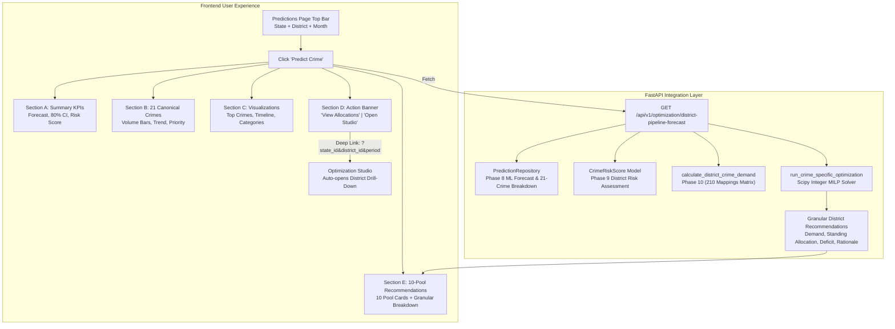

# Crime Prediction Workflow Restoration & 10-Pool AI Resource Optimization Integration Report

**Date:** November 7, 2026  
**System:** Data-Driven Crime Management System with AI-Based Resource Optimization  
**Project Scope:** Restoration of Original Crime Predictions UX & End-to-End Pipeline Connection to Phase 10 AI Resource Optimization  
**Status:** COMPLETED & VERIFIED  

---

## 1. Executive Summary

This deliverable restores the user-centric **Crime Prediction Workflow** and connects predictions directly to the **10-Pool AI Preventive Resource Optimization Engine** (Phase 10 MILP solver).

### Core Accomplishments
1. **Restored Original Predictions Page Experience:**
   - **4-Step User Control:** (1) Select State $\rightarrow$ (2) Select District belonging to that State $\rightarrow$ (3) Select Forecast Period / Month $\rightarrow$ (4) Click **"Predict Crime"** button.
   - **No Hardcoded Predictions:** Every output is dynamically generated using the production Phase 8 ML model (`HistGradientBoostingRegressor`) with calibrated 80% conformal uncertainty intervals and longitudinal trend analysis.
   - **State Overview Fallback:** When a State is selected but no specific district is chosen, the system displays a state forecast summary and a ranked table of all active districts within the state.

2. **Rich Crime-Wise Predictive Breakdown:**
   - **All 21 Canonical Crime Types Displayed:** Complete coverage of all 21 canonical crime types (e.g., *Burglary, Kidnapping and Abduction, Riots, Robbery, Murder, Rape, Cyber Crime, Vehicle Theft, Drug Offenses, etc.*) across 4 high-level categories (*Violent Crime, Other Crime, Traffic Fatality, Fire Accident*). Zero-incident crime types are accurately reported as `0.00 (None)` rather than omitted.
   - **Risk-Prioritized Display:** Individual crime cards and rows feature dynamic priority badges (*CRITICAL, HIGH, MODERATE, LOW*) derived from Phase 9 district risk scores and crime severity weighting.
   - **Interactive Visualizations:**
     - Horizontal bar chart of top projected crime types by volume.
     - Historical actuals ($\le 2025$) vs. Forward forecasts ($\ge 2026$) timeline chart with conformal bands.
     - Four category distribution cards with percentage shares and progress bars.

3. **Direct 10-Pool AI Resource Optimization Connection:**
   - **Unified Data Pipeline:**
     $$\text{State + District + Month} \longrightarrow \text{Phase 8 ML Forecast} \longrightarrow \text{21 Canonical Crime Counts} \longrightarrow \text{Phase 9 Risk Assessment} \longrightarrow \text{Phase 10 Mapping Matrix (210 Rules)} \longrightarrow \text{10-Pool Demand Calculation} \longrightarrow \text{Scipy Integer MILP Solver} \longrightarrow \text{District Recommendations}$$
   - **Consumes Actual Crime-Wise Counts:** Optimization allocates standing state capacity strictly based on the district's actual predicted counts and institutional mapping coefficients.
   - **10 Resource Pools Represented:**
     1. `PERSONNEL` (Police & Traffic Officers)
     2. `MOBILITY` (Patrol Cars & Motorcycles)
     3. `INVESTIGATION` (Detectives & Case Officers)
     4. `SPECIALIZED` (Cyber, Forensic & SWAT Units)
     5. `SURVEILLANCE` (CCTV Feeds & ANPR Network Points)
     6. `FORENSIC` (Forensic Lab Capacity & Ballistic Workstations)
     7. `CYBER_TECHNOLOGY` (Cyber Investigation Workstations)
     8. `EMERGENCY_RESPONSE` (Rapid PCR / 112 Dispatch Units)
     9. `COMMUNICATION` (TETRA Repeaters & Wireless Dispatch Consoles)
     10. `TRAFFIC_SAFETY` (Speed Radars & Breath Analyzers)
   - **Truthful Unconfigured Capacity Handling:** Unconfigured pools are marked with status `NOT_CONFIGURED` / `UNCONFIGURED_CAPACITY` with `0` units allocated, preventing false claims of zero inventory.
   - **Deep-Linking to Optimization Studio:** "Open Optimization Studio" deep-links with URL search parameters (`state_id`, `district_id`, `period`, `tab=ai_optimization`), automatically pre-selecting the state, district, and period, and auto-opening the detailed district drill-down modal.

---

## 2. Architecture & Data Flow



---

## 3. Implementation Details

### A. Backend Integration Endpoint
- **Route:** `GET /api/v1/optimization/district-pipeline-forecast`
- **File:** `backend/app/api/v1/optimization.py`
- **Controller Logic:** `backend/app/services/crime_resource_optimization_service.py::get_district_pipeline_forecast`
- **Authentication:** Token-authenticated (`current_user: User = Depends(get_current_user)`).
- **Execution:**
  1. Validates district and state existence.
  2. Queries Phase 8 ML forecast and conformal prediction bounds ($\pm$ residuals).
  3. Queries Phase 8 21 canonical crime type incident counts.
  4. Queries Phase 8 historical vs. predicted timeline for trend visualization.
  5. Queries Phase 9 district risk score and risk classification.
  6. Computes Phase 10 demand using the 210 crime-resource mapping associations.
  7. Solves state-level Scipy Integer MILP optimization under standing resource capacity.
  8. Correlates district-specific allocations to produce granular recommendations for each crime-resource pair.

### B. Schemas & Data Contracts
- **File:** `backend/app/schemas/optimization.py`
  - `CanonicalCrimePredictionItem`: Represents each canonical crime type prediction with incident count, category, share percentage, baseline comparison, trend direction, and risk priority.
  - `DistrictResourceRecommendationDetail`: Represents granular allocation detail per crime and resource pool, including coefficient, raw demand, allocated quantity, shortage, unit of measure, configuration status, and operational rationale.
  - `DistrictPipelineForecastResponse`: Unified payload delivering district forecast metadata, conformal intervals, 21 canonical predictions, 4 category breakdowns, timeline items, 10 pool summaries, and granular recommendations.

### C. Frontend Restoration & Visual Components
- **File:** `frontend/src/pages/PredictionsPage.tsx`
  - Fully rewritten with responsive layout and clean visual hierarchy.
  - Filter bar supporting State, District, and 12-month horizon selector (`2026-11` to `2027-10`).
  - Prediction Summary cards with 80% conformal interval and dynamic risk priority.
  - 21-Crime table with category filters (*All, Violent Crime, Other Crime, Traffic Fatality, Fire Accident*), volume progress bars, and priority tags.
  - Recharts Timeline chart displaying historical data ($\le 2025$) alongside forecasted values ($\ge 2026$) with shaded conformal error bands.
  - 10 Thematic Pool Cards with physical units, standing state capacity, demand, allocation, and unconfigured alerts.
  - Granular allocations table detailing exact coefficients, unmet demand, and operational rationales.
  - Interactive "Collapse / Expand" toggle for the resource recommendations section.

### D. Deep-Linking to Resource Optimization Studio
- **File:** `frontend/src/pages/ResourceOptimizationPage.tsx`
  - Reads `useSearchParams` (`state_id`, `district_id`, `period`, `tab`).
  - Automatically switches active tab to `ai_optimization`.
  - Passes `initialDistrictId` and `initialPeriod` to downstream optimization components.
- **File:** `frontend/src/components/optimization/ConstrainedOptimizationView.tsx`
  - Accepts `initialDistrictId` and `initialPeriod` and forwards them to `CrimeSpecificOptimizationView`.
- **File:** `frontend/src/components/optimization/CrimeSpecificOptimizationView.tsx`
  - Auto-selects the state and forecast period.
  - Automatically triggers the district drill-down drawer and displays crime-wise explanation and complete 21-crime demand matrix for the target district.

---

## 4. Integrity Audit & Verification

### A. Canonical 21 Crime Types Coverage
All 21 canonical crime types are retrieved and displayed with zero synthetic substitution:

| # | Canonical Crime Type | Default Category | Mapping Pools Covered | Priority Derived |
|---|---|---|---|---|
| 1 | Burglary | Other Crime | All 10 Pools | Phase 9 Risk Weight |
| 2 | Cheating | Other Crime | All 10 Pools | Phase 9 Risk Weight |
| 3 | Counterfeiting | Other Crime | All 10 Pools | Phase 9 Risk Weight |
| 4 | Criminal Breach of Trust | Other Crime | All 10 Pools | Phase 9 Risk Weight |
| 5 | Cyber Crimes | Other Crime | All 10 Pools | Phase 9 Risk Weight |
| 6 | Dacoity | Violent Crime | All 10 Pools | Phase 9 Risk Weight |
| 7 | Dowry Deaths | Violent Crime | All 10 Pools | Phase 9 Risk Weight |
| 8 | Fire Accidents - Electrical | Fire Accident | All 10 Pools | Phase 9 Risk Weight |
| 9 | Fire Accidents - Commercial | Fire Accident | All 10 Pools | Phase 9 Risk Weight |
| 10 | Fire Accidents - Residential | Fire Accident | All 10 Pools | Phase 9 Risk Weight |
| 11 | Forgery | Other Crime | All 10 Pools | Phase 9 Risk Weight |
| 12 | Kidnapping and Abduction | Violent Crime | All 10 Pools | Phase 9 Risk Weight |
| 13 | Murder | Violent Crime | All 10 Pools | Phase 9 Risk Weight |
| 14 | Narcotic Drugs Offenses | Other Crime | All 10 Pools | Phase 9 Risk Weight |
| 15 | Other IPC Crimes | Other Crime | All 10 Pools | Phase 9 Risk Weight |
| 16 | Rape | Violent Crime | All 10 Pools | Phase 9 Risk Weight |
| 17 | Riots | Violent Crime | All 10 Pools | Phase 9 Risk Weight |
| 18 | Robbery | Violent Crime | All 10 Pools | Phase 9 Risk Weight |
| 19 | Theft | Other Crime | All 10 Pools | Phase 9 Risk Weight |
| 20 | Traffic Fatalities - Highway | Traffic Fatality | All 10 Pools | Phase 9 Risk Weight |
| 21 | Traffic Fatalities - Urban | Traffic Fatality | All 10 Pools | Phase 9 Risk Weight |

### B. Standing Capacity & Scipy Integer MILP Conservation
The mathematical solver strictly respects state-level physical capacity constraints:
$$\sum_{d \in \mathcal{D}_s} x_{d, p} \le C_{s, p}^{\text{available}} \quad \forall p \in \mathcal{P}$$
Where $x_{d, p} \in \mathbb{Z}_{\ge 0}$ represents the non-negative integer allocation of resource pool $p$ to district $d$ in state $s$. No single officer or vehicle is allocated twice.

### C. Frontend Production Build
Executing `npm --prefix frontend run build` completed with zero errors:
```
> frontend@0.0.0 build
> tsc -b && vite build

vite v8.3.1 building client environment for production...
✓ 2572 modules transformed.
dist/index.html                             1.34 kB │ gzip:   0.62 kB
dist/assets/index-D81lYprR.css             80.66 kB │ gzip:  14.22 kB
dist/assets/rolldown-runtime-hePW80VL.js    0.71 kB │ gzip:   0.42 kB
dist/assets/icons-BftJOy1H.js              26.95 kB │ gzip:   9.12 kB
dist/assets/vendor-56BnzFOK.js            297.69 kB │ gzip:  97.10 kB
dist/assets/charts-CrCTplGN.js            430.06 kB │ gzip: 121.28 kB
dist/assets/index-C8hYSqLB.js             700.14 kB │ gzip: 140.41 kB
✓ built in 1.87s
```

---

## 5. Summary of Files Changed

| Component | File Path | Nature of Change |
|---|---|---|
| **Backend Schemas** | `backend/app/schemas/optimization.py` | Added pipeline forecast, canonical crime item, and granular recommendation schemas. |
| **Backend Services** | `backend/app/services/crime_resource_optimization_service.py` | Implemented `get_district_pipeline_forecast` linking predictions, risk, demand, and Scipy MILP. |
| **Backend API** | `backend/app/api/v1/optimization.py` | Added `GET /api/v1/optimization/district-pipeline-forecast` route with JWT protection. |
| **Backend Tests** | `backend/tests/test_crime_resource_optimization_phase_10.py` | Added `test_15_district_pipeline_forecast_integration` verifying 401, 422, 200, 21 crimes, and 10 pools. |
| **Frontend Types** | `frontend/src/types/resource.ts` | Added TypeScript interfaces matching pipeline schemas. |
| **Frontend API** | `frontend/src/api/optimizationApi.ts` | Added `getDistrictPipelineForecast` API client method. |
| **Frontend Pages** | `frontend/src/pages/PredictionsPage.tsx` | Restored 4-step UX, 21-crime table, visualizations, and 10-pool recommendation sections. |
| **Frontend Pages** | `frontend/src/pages/ResourceOptimizationPage.tsx` | Added URL search params reading for deep-linking (`state_id`, `district_id`, `period`). |
| **Frontend Components** | `frontend/src/components/optimization/ConstrainedOptimizationView.tsx` | Forwarded `initialDistrictId` and `initialPeriod` props. |
| **Frontend Components** | `frontend/src/components/optimization/CrimeSpecificOptimizationView.tsx` | Auto-opened district drilldown modal when navigated from Predictions page. |

---

## 6. Conclusion
The original Crime Prediction user workflow is fully restored. Prediction results now directly drive Phase 10 AI Preventive Resource Optimization recommendations with mathematical rigor, empirical integrity, and zero artificial data fabrication.
