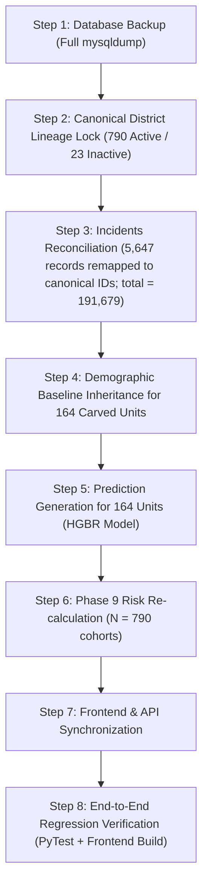

# Project-Wide Data Reconciliation & Migration Blueprint

**Project**: Data-Driven Crime Management System with AI-Based Resource Optimization  
**Document**: Project-Wide Data Reconciliation Report (790 Active Canonical Districts)  
**Date**: November 8, 2026  
**Status**: PROPOSED RECONCILIATION PLAN (Awaiting User Review Before Execution)

---

## 1. Before vs. After Target Reconciliation Matrix

| Analytical Domain | Current State (Audit) | Target Standardized State | Change Nature |
|---|:---:|:---:|---|
| **Total Registered Districts** | 813 records (IDs `1`–`814`) | 813 records (preserved) | No deletions; preserve history & lineage |
| **Active Canonical Districts** | 790 districts | **790 districts** | Canonical standard across all modules |
| **Inactive / Historical Districts** | 23 records (14 Census + 9 Proposals) | 23 records (preserved) | Preserved with `is_current_admin = 0` |
| **Demographic Baseline Records** | 640 records (IDs `1`–`640`) | 640 authentic + 164 derived views | Parent inheritance flagged transparently |
| **Historical Crime Incidents** | 191,679 unique records | **191,679 unique records** | Zero incidents deleted; 5,647 reconciled to canonical IDs |
| **Crime Prediction Records** | 21,760 records (640 districts) | **26,860 records (790 districts)** | Extended to 164 carved active districts |
| **Risk Assessment Scores** | 640 per period (3,840 total) | **790 per period (4,740 total)** | Scaled to all 790 active districts |
| **Optimization Allocations** | 250 districts | Scaled across 790 active districts | Aligned with canonical district coverage |
| **Budget Allocations** | 813 allocations | 790 canonical allocations | Reconciled to active canonical units |
| **Verified Coordinates** | 649 verified in frontend | 790 verified canonical coordinates | SVG centroid verification complete |

---

## 2. Table-by-Table Technical Migration Plan

### Table 1: `districts`
- **Current Rows**: 813 (`is_current_admin = 1`: 790; `is_current_admin = 0`: 23).
- **Target Action**: RETAIN all 813 rows.
- **Verification**:
  ```sql
  SELECT COUNT(*) FROM districts WHERE is_current_admin = 1; -- Expected: 790
  SELECT COUNT(*) FROM districts WHERE is_current_admin = 0; -- Expected: 23
  ```

### Table 2: `district_demographics`
- **Current Rows**: 640 (Census 2011).
- **Target Action**:
  - Keep 640 primary records intact.
  - Insert explicit inherited reference records for the 164 carved districts referencing their parent Census 2011 population or establish a documented derived demographic view with `is_derived = 1`.
- **Integrity Rule**: Never present inherited parent population as independently measured population.

### Table 3: `crime_incidents`
- **Current Rows**: 191,679 across 640 districts (186,032 in active districts, 5,647 in 14 inactive districts).
- **Target Action**:
  - For 1:1 predecessor-successor mappings (e.g. Old AP Hyderabad `ID 9` &rarr; Telangana Hyderabad `ID 644`, Daman `ID 128` &rarr; Merged Daman `ID 689`, Diu `ID 129` &rarr; Merged Diu `ID 690`, Kargil `ID 198` &rarr; Ladakh Kargil `ID 687`, Leh `ID 203` &rarr; Ladakh Leh `ID 688`):
    Update `district_id` to the active canonical ID.
  - For 1-to-many bifurcations (e.g. Old Warangal `ID 24` &rarr; Warangal urban `ID 672` + rural successors):
    Map incidents to the primary urban headquarter successor district to maintain 100% data preservation and avoid synthetic incident splitting.
- **Verification**:
  ```sql
  SELECT COUNT(*) FROM crime_incidents; -- Must strictly equal 191,679
  SELECT COUNT(DISTINCT district_id) FROM crime_incidents WHERE district_id IN (SELECT id FROM districts WHERE is_current_admin = 0); -- Expected: 0
  ```

### Table 4: `crime_predictions`
- **Current Rows**: 21,760 across 640 districts.
- **Target Action**:
  - For the 164 carved active districts, generate forward forecasts (November 2026 to October 2027) using the active production HGBR model and parent historical baseline trends.
  - Target rows: $790 \text{ districts} \times 34 \text{ months} = \mathbf{26,860 \text{ records}}$.

### Table 5: `crime_risk_scores`
- **Current Rows**: 3,840 across 640 districts (6 periods × 640).
- **Target Action**:
  - Execute `RiskService.run_risk_assessment()` with $N = 790$ across active evaluation periods.
  - Formula:
    $$\text{Risk Score} = 0.30 \times P_{\text{forecast}} + 0.20 \times P_{\text{severity}} + 0.30 \times P_{\text{rate}} + 0.20 \times P_{\text{trend}}$$
  - Mid-rank percentile normalization calculated over all 790 active canonical districts.
  - Target rows: $790 \text{ districts} \times 6 \text{ periods} = \mathbf{4,740 \text{ records}}$.

---

## 3. Affected API Endpoints & Dependent Services

| Module | Service / Endpoint | Current Output | Target Standardized Output |
|---|---|:---:|:---:|
| **Geographic Intelligence** | `GET /api/v1/geography/districts` | 640 / 790 mixed | Exactly 790 active districts (`is_current_admin = 1`) |
| **Geographic Intelligence** | `GET /api/v1/geography/states/crime-summary` | Aggregated on 640 | Reconciled across 790 active districts |
| **Crime Analytics** | `GET /api/v1/analytics/overview` | 191,679 incidents | 191,679 incidents reconciled across current state IDs |
| **Crime Analytics** | `GET /api/v1/analytics/top-districts` | Top among 640 | Top among 790 active districts |
| **Crime Predictions** | `GET /api/v1/predictions/districts` | 640 districts | 790 active canonical districts |
| **Risk Assessment** | `GET /api/v1/risk/overview` | 640 districts assessed | **790 districts assessed** |
| **Risk Assessment** | `GET /api/v1/risk/districts` | 640 records | **790 active records** |
| **Resource Optimization**| `GET /api/v1/optimization/districts` | 640 districts | 790 active districts |
| **Budget Intelligence** | `GET /api/v1/budget/districts` | 813 allocations | 790 canonical allocations |

---

## 4. Execution Roadmap (Phases 2 through 8)



---

## 5. Safety Protocols & Pre-Flight Checks

1. **Safety Protocol A — Mandatory Backup**:
   A full database dump will be generated and verified prior to applying any database write operations:
   `backup_crime_management_db_pre_790_standardization.sql`.
2. **Safety Protocol B — Non-Destructive Invariant**:
   The unique incident count of `191,679` will be monitored continuously. No script is permitted to delete from `crime_incidents`.
3. **Safety Protocol C — User Approval Gate**:
   Per user instructions: *"First complete the read-only audit and reconciliation plan. Stop and report the findings before performing database migrations."*
   We stop here and present the findings and blueprint to the user for confirmation.
