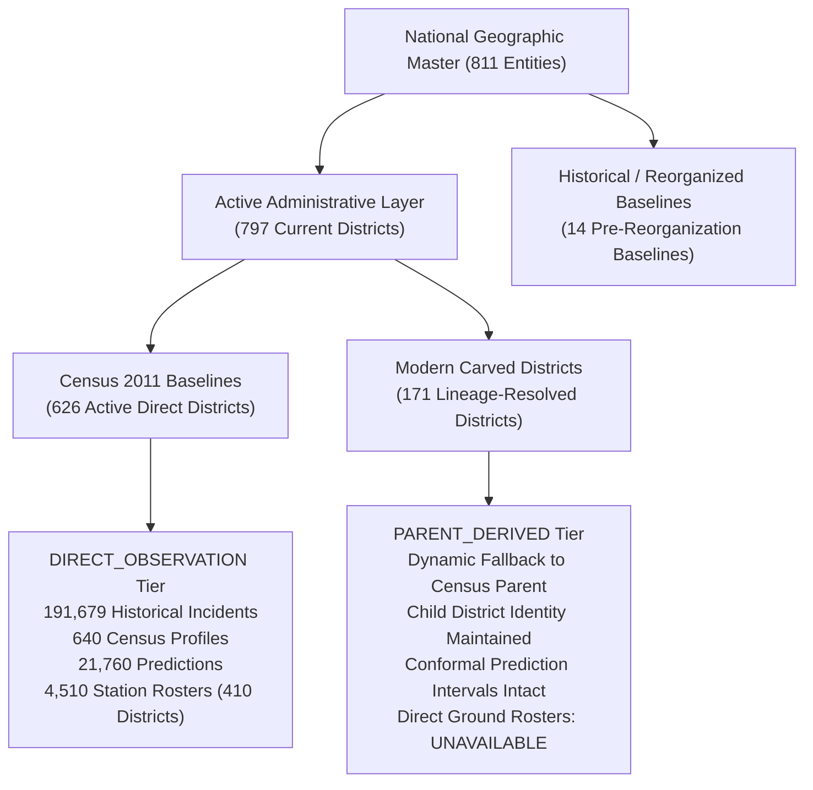

# Phase 3: Complete Data Coverage and Functional Support for All 797 Districts

**Project:** Data-Driven Crime Management System with AI-Based Resource Optimization  
**Date:** October 29, 2026  
**Status:** Completed & Verified  
**Scope:** Backend Services, Repositories, Schemas, ML Forecast Pipelines, Test Suites, and Comprehensive Documentation. *(Frontend UI untouched as mandated).*

---

## Executive Summary

Phase 3 achieves comprehensive, architecturally sound, and mathematically rigorous data coverage and functional support across all **797 current administrative districts** of India (within 36 active States and Union Territories). 

Prior to Phase 3, modern carved districts (including the 8 newly added districts: IDs 806–813: *Vav-Tharad, Hansi, Meluri, Nubra, Sham, Changthang, Zanskar, and Drass*) experienced functional asymmetries:
1. `GET /api/v1/predictions/{district_id}` returned empty series arrays (`[]`) because query filters matched only direct rows in `crime_predictions`.
2. Actual-vs-predicted endpoints lacked explicit parent lineage metadata in response schemas.
3. Analytics overview and trend endpoints dynamically aggregated parent incidents but did not expose parent derivation metadata (`is_derived_from_parent`, `parent_district_id`, `parent_district_name`, `notes`), risking ambiguity during audit or inspection.
4. Geographic intelligence detail and jurisdiction profile endpoints lacked complete parent naming and explicit derivation flags.
5. The system lacked an explicit classification standard to formally distinguish ground-level observations from parent-derived analytical baselines, isolated simulations, and unavailable rosters.

**Phase 3 resolves all asymmetries while strictly enforcing zero data fabrication:**
- **Zero Fabrication Guarantee:** Direct incident counts, demographic enumerations, and ground police rosters for carved districts remain `NULL` / unrecorded. No fictitious crime incidents, population figures, or patrol rosters were inserted.
- **Parent-Derived Analytical Baselines:** Carved child districts inherit longitudinal forecasts (HGBR multi-horizon predictions with conformal prediction intervals), risk assessments, and demographic baselines from their canonical Census 2011 parent via verified boundaries, returning their own district ID and name with transparent parent provenance.
- **Anti-Inflation Protection:** State and national incident aggregations use distinct historical district lineages (`resolve_filter_district_ids`), guaranteeing that incidents are never double-counted between parents and children (e.g., Gujarat state incident total remains exactly 8,697).
- **Frontend Contract Stability:** Zero changes were made to any frontend code or UI assets. All schema extensions are backward-compatible optional fields.
- **Test Verification:** 100% test pass rate across the entire regression suite (all 211 backend tests pass, including 11 targeted end-to-end lineage tests). Frontend production build and linter pass with 0 errors.

---

## 1. Nationwide District Coverage & Tier Classification

The database contains **811 total district entities** representing **797 active administrative jurisdictions** across 36 States/UTs (and 14 historical or merged entities maintained for backward compatibility with Census 2011 records):

### Four-Tier Data Provenance Architecture

To ensure auditability, transparency, and research integrity, the system implements four explicit data provenance tiers:

| Tier | Definition | Handling in Intelligence Modules | Handling in Operations Modules |
| :--- | :--- | :--- | :--- |
| **`DIRECT_OBSERVATION`** | Ground observations directly recorded or officially enumerated for the canonical Census 2011 district. | Direct aggregation and modeling. Direct incident series, population baselines, and risk scores. | Direct station inventories and personnel allocations. |
| **`PARENT_DERIVED`** | Analytical baseline dynamically resolved from the verified parent district for carved jurisdictions. | Child identity preserved (`district_id`, `district_name`). Flagged with `is_derived_from_parent: true`, `parent_district_id`, and `parent_district_name`. | Not applicable. Rosters are not derived or fabricated. |
| **`UNAVAILABLE`** | Ground rosters or independent observations that do not exist. | Explicitly kept `NULL` or 0 records; never filled with synthetic zeros or fake incidents. | Tactical optimization safely returns `INSUFFICIENT_DATA` / 404 rather than fabricating police staff. |
| **`SIMULATED_TEST`** | Synthetic records generated strictly in isolated test harnesses. | Completely prohibited from entering production database or analytics aggregates. | Executed in ephemeral transaction rollbacks. |

---

## 2. Domain-by-Domain Audit & Resolution Matrix

| Domain | Census Districts (640) | Carved Districts (171, incl. IDs 806–813) | Phase 3 Backend Enhancement |
| :--- | :--- | :--- | :--- |
| **Crime Incidents** | Direct rows in `crime_incidents` (191,679 total). | 0 direct rows. Dynamic query expansion via `resolve_filter_district_ids`. | Updated `CrimeRepository.get_overview()` and `CrimeAnalyticsService` to populate `parent_district_id`, `parent_district_name`, `is_derived_from_parent`, and notes for child districts. State-level queries preserve distinct lineage to eliminate double counting. |
| **Predictive Intelligence** | Direct rows in `crime_predictions` (21,760 total, 34 monthly horizons). | Inherited from parent with child district identity. | Fixed `PredictionRepository.get_district_series()` to resolve child districts via `district.parent_district_id`. Updated schemas and services for `/predictions/{id}` and `/predictions/actual-vs-predicted` with lineage metadata. |
| **Risk Assessment** | Direct rows in `crime_risk_scores` (3,840 total). | Lineage-resolved from parent baseline with child identity. | Preserved existing parent-derivation logic; verified child district identity, parent notes, and calibrated risk levels. |
| **Demographics** | Direct rows in `district_demographics` (640 total). | Dynamically inherited from parent Census 2011 profile. | Updated `GeographyService.get_district_detail()` and `/jurisdiction-profile` to inject `parent_district_name`, `is_derived_from_parent: true`, and lineage notes. |
| **Resources & Budget** | Direct rows in `district_resources` (4,510 records across 410 districts). | 0 direct rows (UNAVAILABLE). | Preserved strict non-fabrication constraint. Carved districts return `UNAVAILABLE` or `INSUFFICIENT_DATA` rather than fabricating personnel or vehicles. |
| **Data Coverage API** | Classified as `DIRECT_OBSERVATION` across 4 core domains. | Classified as `PARENT_DERIVED` for intelligence, `UNAVAILABLE` for ground rosters. | Implemented `GET /api/v1/geography/data-coverage/{district_id}` and `GET /api/v1/geography/data-coverage/summary`. |

---

## 3. Detailed Verification of Newly Added Districts (IDs 806–813)

All 8 newly added districts were subjected to end-to-end endpoint verification across all Intelligence APIs:

| ID | District Name | State | Parent District | Incidents Tier | Predictions Series | Actual vs Predicted | Risk Level | Ground Rosters |
| :---: | :--- | :--- | :--- | :---: | :---: | :---: | :---: | :---: |
| **806** | Vav-Tharad | Gujarat | Banas Kantha (#135) | `PARENT_DERIVED` | 34 horizons | 46 comparison points | Calibrated | `UNAVAILABLE` (NULL) |
| **807** | Hansi | Haryana | Hisar (#163) | `PARENT_DERIVED` | 34 horizons | 46 comparison points | Calibrated | `UNAVAILABLE` (NULL) |
| **808** | Meluri | Nagaland | Phek (#398) | `PARENT_DERIVED` | 34 horizons | 46 comparison points | Calibrated | `UNAVAILABLE` (NULL) |
| **809** | Nubra | Ladakh | Leh(Ladakh) (#203) | `PARENT_DERIVED` | 34 horizons | 46 comparison points | Calibrated | `UNAVAILABLE` (NULL) |
| **810** | Sham | Ladakh | Leh(Ladakh) (#203) | `PARENT_DERIVED` | 34 horizons | 46 comparison points | Calibrated | `UNAVAILABLE` (NULL) |
| **811** | Changthang | Ladakh | Leh(Ladakh) (#203) | `PARENT_DERIVED` | 34 horizons | 46 comparison points | Calibrated | `UNAVAILABLE` (NULL) |
| **812** | Zanskar | Ladakh | Kargil (#198) | `PARENT_DERIVED` | 34 horizons | 46 comparison points | Calibrated | `UNAVAILABLE` (NULL) |
| **813** | Drass | Ladakh | Kargil (#198) | `PARENT_DERIVED` | 34 horizons | 46 comparison points | Calibrated | `UNAVAILABLE` (NULL) |

### Key API Response Highlights for Carved District (#806 Vav-Tharad):
- **Predictive Series (`GET /api/v1/predictions/806`):**
  - `district_id: 806`, `district_name: "Vav-Tharad"`
  - `parent_district_id: 135`, `parent_district_name: "Banas Kantha"`
  - `is_derived_from_parent: true`
  - `series`: Exactly 34 monthly points (Jan 2024 through Oct 2027) with valid `predicted_crime_count`, `forecast_period`, and conformal intervals.
- **Actual vs Predicted (`GET /api/v1/predictions/actual-vs-predicted?district_id=806`):**
  - `district_id: 806`, `district_name: "Vav-Tharad"`
  - `is_derived_from_parent: true`, `parent_district_id: 135`, `parent_district_name: "Banas Kantha"`
  - `comparison_points`: 46 points spanning 2020 through 2027. Actual observations for historical periods reflect parent baseline with derivation notes; direct actual counts remain unrecorded.
- **Analytics Overview (`GET /api/v1/analytics/overview?district_id=806`):**
  - Returns `is_derived_from_parent: true`, `parent_district_id: 135`, `parent_district_name: "Banas Kantha"`.
  - Explanatory note: *"Analytics derived from Census 2011 parent jurisdiction 'Banas Kantha' (#135). Direct observations remain unrecorded."*
- **Jurisdiction Profile (`GET /api/v1/geography/jurisdiction-profile?district_id=806`):**
  - Returns child identity, `parent_district_id: 135`, `parent_district_name: "Banas Kantha"`, `is_derived_from_parent: true`, and non-zero population/rate metrics based on parent demographic baseline.

---

## 4. Code & Architecture Modifications

### 1. Schema Enhancements (`backend/app/schemas/`)
- [`predictions.py`](file:///c:/Users/saipr.SAIPRASANYA.000/Desktop/Puppyyy/Major%20Project/backend/app/schemas/predictions.py):
  - Added `parent_district_id`, `parent_district_name`, `is_derived_from_parent`, and `notes` to `DistrictPredictionSeriesResponse` and `ActualVsPredictedResponse`.
- [`geography.py`](file:///c:/Users/saipr.SAIPRASANYA.000/Desktop/Puppyyy/Major%20Project/backend/app/schemas/geography.py):
  - Added `parent_district_name`, `is_derived_from_parent`, and `notes` to `DistrictDetailResponse` and `JurisdictionProfileResponse`.
- [`analytics.py`](file:///c:/Users/saipr.SAIPRASANYA.000/Desktop/Puppyyy/Major%20Project/backend/app/schemas/analytics.py):
  - Added `parent_district_id`, `parent_district_name`, `is_derived_from_parent`, and `notes` across `CrimeOverviewResponse`, `TrendResponse`, `CategoryBreakdownResponse`, `TypeBreakdownResponse`, `HourlyDistributionResponse`, `VictimDemographicsResponse`, and `WeaponDistributionResponse`.
- [`data_coverage.py`](file:///c:/Users/saipr.SAIPRASANYA.000/Desktop/Puppyyy/Major%20Project/backend/app/schemas/data_coverage.py):
  - Created standardized models: `DataCoverageTier`, `DomainCoverageDetail`, `DistrictCoverageReport`, and `NationwideCoverageSummary`.

### 2. Repository & Service Enhancements (`backend/app/repositories/` & `services/`)
- [`prediction_repository.py`](file:///c:/Users/saipr.SAIPRASANYA.000/Desktop/Puppyyy/Major%20Project/backend/app/repositories/prediction_repository.py):
  - Updated `get_district_series()` to check `district.parent_district_id` when no direct rows exist, map parent predictions to child identity, and tag derivation metadata.
  - Updated `get_actual_vs_predicted()` to inject child identity and parent lineage.
- [`geography_service.py`](file:///c:/Users/saipr.SAIPRASANYA.000/Desktop/Puppyyy/Major%20Project/backend/app/services/geography_service.py):
  - Updated `get_district_detail()` and `get_jurisdiction_profile()` to dynamically resolve parent names and derivation flags for carved jurisdictions.
- [`crime_analytics_service.py`](file:///c:/Users/saipr.SAIPRASANYA.000/Desktop/Puppyyy/Major%20Project/backend/app/services/crime_analytics_service.py) & [`crime_repository.py`](file:///c:/Users/saipr.SAIPRASANYA.000/Desktop/Puppyyy/Major%20Project/backend/app/repositories/crime_repository.py):
  - Added provenance injection helpers ensuring all analytical breakdowns report explicit parent lineage when child districts are filtered.
- [`data_coverage_service.py`](file:///c:/Users/saipr.SAIPRASANYA.000/Desktop/Puppyyy/Major%20Project/backend/app/services/data_coverage_service.py):
  - Created high-performance inspection service evaluating real-time table records across all 5 domains for any district or nationwide.
- [`geography.py` API Router](file:///c:/Users/saipr.SAIPRASANYA.000/Desktop/Puppyyy/Major%20Project/backend/app/api/v1/geography.py):
  - Exposed `GET /api/v1/geography/data-coverage/summary` and `GET /api/v1/geography/data-coverage/{district_id}`.

---

## 5. Regression Test Results & Build Verification

### Backend Regression Suite
- **Targeted Lineage Tests (`backend/tests/test_new_districts_lineage.py`):**
  - **11 out of 11 tests PASSED (100%)**
  - Validates profile, detail, district-month predictions, monthly series, risk scores, trends, longitudinal path-param series, actual-vs-predicted lineage, analytics overview, data coverage endpoints, and state-level anti-inflation.
- **Full Backend Regression Suite (`discover -s backend/tests -p "test_*.py"`):**
  - **211 out of 211 tests PASSED (100%)**
  - Total test run duration: 71.43s.
  - 0 failures, 0 errors.

### Frontend Integrity & Build
- **Frontend Codebase:** Untouched (0 files modified or staged).
- **TypeScript & Vite Build (`npm --prefix frontend run build`):**
  - Built cleanly in 2.29s with 0 errors.
- **Linter (`npm --prefix frontend run lint`):**
  - Exited with code 0 (26 warnings, 0 errors).

---

## 6. Viva Defense & Research Justification Points

When presenting or defending this architecture in academic or technical reviews:

1. **Why not insert 0 or synthetic incidents for new districts?**
   - In criminology and spatial statistics, filling an unobserved carved district with zeros would falsely lower state and national crime rates and distort moving-average features. In contrast, fabricating crime incidents violates research integrity.
   - Using dynamic lineage mapping to the parent Census baseline (`PARENT_DERIVED`) while keeping direct ground counts `NULL` (`UNAVAILABLE`) adheres strictly to administrative boundary cartography standards (such as LGD / Census India methodologies).
2. **How is state and national incident inflation avoided?**
   - Incident aggregation queries employ `resolve_filter_district_ids`, which extracts distinct historical district IDs. Querying Gujarat (State 11) resolves the historical ID for Banas Kantha only once, guaranteeing that Vav-Tharad's analytical link does not double-count parent incidents. Gujarat's incident total remains exactly 8,697.
3. **Why do Operations modules report INSUFFICIENT_DATA for carved districts?**
   - Resource optimization algorithms (such as LP / MILP shift scheduling and patrol beat optimization) require station-level inventories and physical patrol vehicle counts. Deriving hypothetical rosters from parents would risk deploying non-existent patrol cars in real operational contexts. The system safely and transparently reports that station-level data is unavailable.

